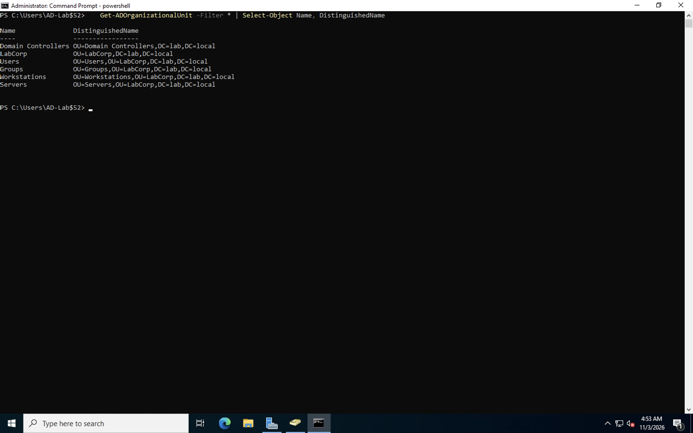
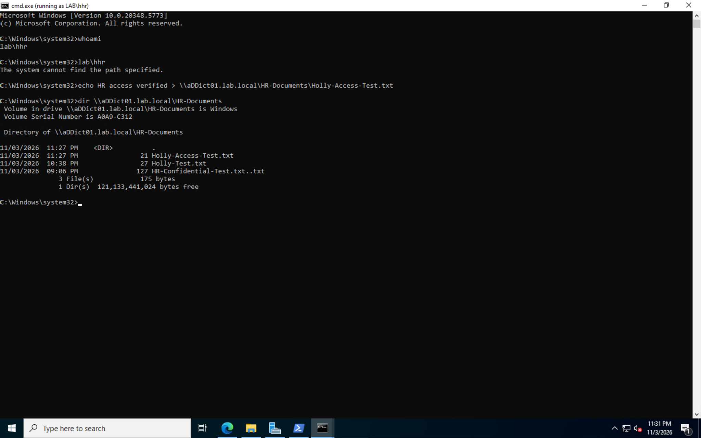

# Active Directory User Management & Role-Based Access Control Lab

## Overview

I built an Active Directory lab using Windows Server virtual machines in Microsoft Azure to get more hands-on experience with user management, security groups, and access control.

The goal was to simulate a small business environment where employees work in different departments and only have access to the files and resources they need. I wanted to practice some of the real-world tasks that IT support technicians and system administrators deal with.

For this lab, I created organizational units, user accounts, and security groups. I also set up a shared HR folder and configured permissions to control who could access it.

To make sure everything worked, I tested the folder using separate HR and Sales accounts. The HR account was able to create files, while the Sales account was denied access.

## Technologies Used

- Microsoft Azure
- Windows Server
- Active Directory Domain Services (AD DS)
- Active Directory Users and Computers (ADUC)
- PowerShell
- DNS
- NTFS Permissions
- SMB File Sharing
- Remote Desktop Protocol (RDP)

## Lab Environment

| Component | Configuration |
|---|---|
| Cloud Platform | Microsoft Azure |
| Domain | lab.local |
| Domain Controller | aDDict01 |
| Domain Client | aDClient01 |
| Main Organizational Unit | LabCorp |
| Security Groups | IT-Admins, HR-Staff, Sales-Staff |
| Shared Folder | HR-Documents |

## 1. Creating Organizational Units

I started by creating a parent organizational unit called `LabCorp` and organizing it into four smaller OUs:

- Users
- Groups
- Servers
- Workstations

I did this to keep the Active Directory environment organized and make it easier to manage different types of accounts and devices.

After creating the OUs, I used PowerShell and Active Directory Users and Computers to verify that everything was set up correctly.




## 2. Creating Security Groups

Next, I created three security groups for different departments:

- IT-Admins
- HR-Staff
- Sales-Staff

The purpose of these groups was to make managing permissions very simple. Instead of giving every employee access individually, I could assign permissions to a group and manage access through group membership.

I verified the groups using PowerShell and Active Directory Users and Computers.


## 3. Creating Domain Users

I created several test accounts to represent employees working in different departments:

- Alex Admin
- Holly HR
- Matt Johnson
- Sam Sales

I used PowerShell and Active Directory Users and Computers to create and verify the accounts.

This gave me more practice with one of the most common responsibilities in IT support: creating and managing employee accounts.


## 4. Managing Group Membership

After creating the users, I assigned them to their appropriate security groups.

For example, Holly was assigned to the HR group, and Sam was assigned to the Sales group.

This helped me to understand how companies can manage access, based on an employee's department or job responsibilities instead of setting permissions for every user separately.


## 5. Configuring NTFS and Share Permissions

For this part of the lab, I created a folder called `HR-Documents` on the domain controller and shared it over the network.

I configured NTFS and share permissions so that the HR-Staff group could access and modify files in the folder.

The goal was to make sure HR employees had the access they needed while employees from other departments couldn't access confidential HR documents.

This was my first real opportunity in the lab to test how security groups, NTFS permissions, and network sharing all work simultaneously together.

## 6. Testing Unauthorized Access — Sales

Once the permissions were configured, I wanted to make sure they actually worked.

I opened Command Prompt using the Sales account and tried accessing the HR shared folder.

Windows returned:

`Access is denied.`

This was the result I wanted because the Sales account wasn't supposed to have access to HR files.

It confirmed that the access restrictions were working for the Sales account.


## 7. Testing Authorized Access — HR

After confirming that Sales couldn't access the folder, I tested the HR account to make sure authorized users could access it.

I opened Command Prompt using Holly's HR account and ran `whoami` to verify which account I was using.

```cmd
whoami
```

The result was:

```text
lab\hhr
```

Next, I created a test file inside the shared HR folder using Command Prompt.

```cmd
echo HR access verified > \\aDDict01.lab.local\HR-Documents\Holly-Access-Test.txt
```

I then ran the following command to check whether the file was successfully created:

```cmd
dir \\aDDict01.lab.local\HR-Documents
```

The file appeared in the folder, Holly's HR account had permission to create files.

This was important because I wanted to verify both sides of the permissions: authorized users should have access, and unauthorized users should be denied.



## Troubleshooting

I ran into a few problems while building this lab, especially when connecting to the domain and testing user permissions.

Some of the issues I worked through included:

- Incorrect domain account credentials when trying to authenticate
- Checking DNS and domain controller connectivity
- Figuring out the correct usernames for domain accounts
- Configuring NTFS and shared folder permissions
- Testing folder access using different domain accounts

I used PowerShell, `nltest`, `whoami`, and Command Prompt to troubleshoot these issues.

One thing I learned was that successfully creating a user or security group doesn't automatically mean everything is configured correctly. I still needed to test the accounts and permissions to make sure they worked the way I intended.

## Skills Demonstrated

- Active Directory Administration
- Windows Server Administration
- User Account Management
- Organizational Unit Management
- Security Group Administration
- Role-Based Access Control
- NTFS and SMB Permissions
- PowerShell
- DNS Troubleshooting
- Authentication and Authorization
- Windows Troubleshooting
- Technical Documentation

## Results

By the end of this lab, I had a working Active Directory environment with organizational units, user accounts, security groups, and a shared folder with restricted permissions.

I successfully tested two different accounts:

- **Holly HR:** Was able to access the HR folder and create a test file.
- **Sam Sales:** Was denied access to the HR folder.

The biggest thing I took away from this lab was understanding how Active Directory groups and file permissions work together to control access to company resources.

I also got more comfortable using PowerShell, troubleshooting authentication issues, and verifying that my configurations actually worked.

These are skills I want to keep building as I work toward a career in IT support and cybersecurity.

Successfully configured an Active Directory environment with departmental organizational units, domain users, and security groups.

Implemented role-based access controls on a shared HR folder and verified that the HR account could create files while the Sales account was denied access.

This project strengthened my understanding of identity management, Windows Server administration, and access control concepts used in IT support and system administration.
